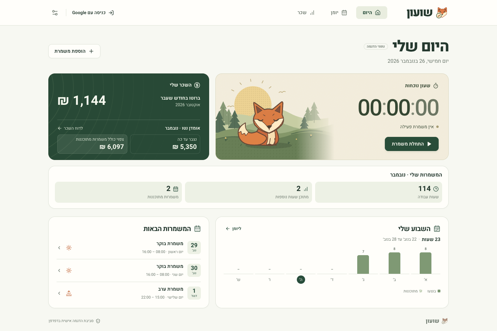
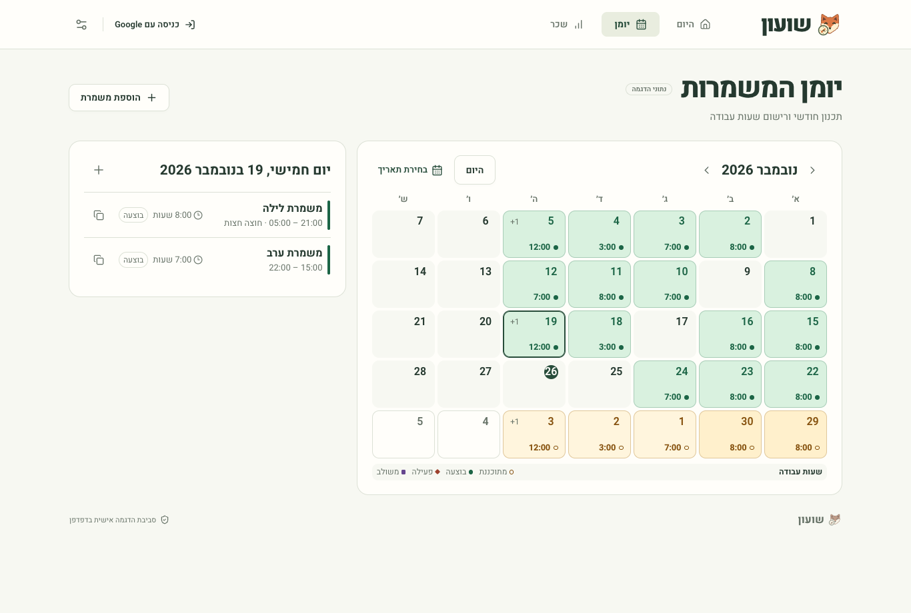
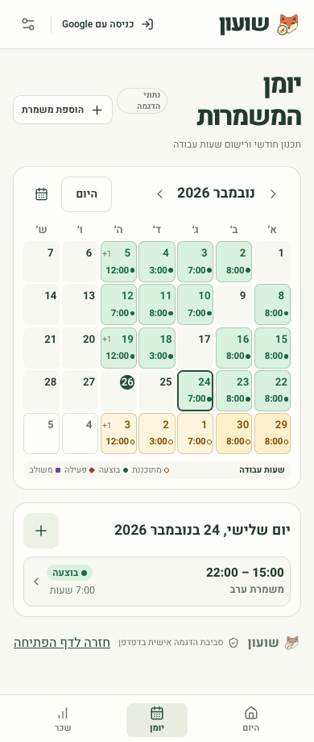
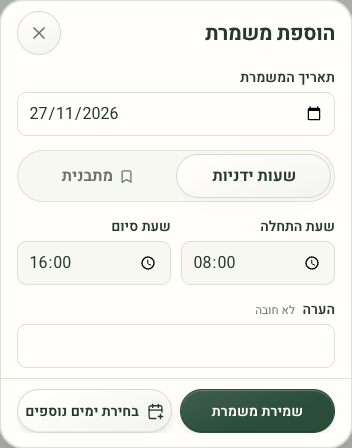
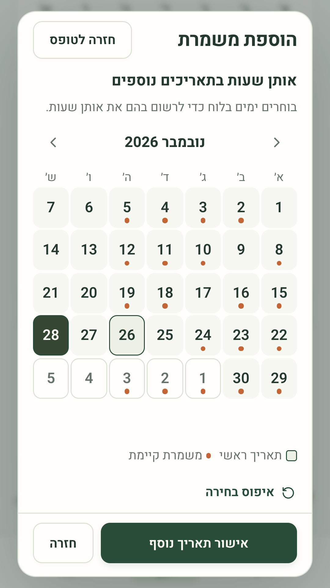

# שועון 🦊

יומן אישי בעברית לעובדים לפי שעה בישראל. מסך הבית מציג את הברוטו של החודש הקודם, את אומדן הנטו שנצבר החודש ואת התחזית הכוללת משמרות מתוכננות. בסיכום החודשי מופיעים שעות העבודה, השעות הנוספות והמשמרות המתוכננות. אפשר להתחיל שעון נוכחות, להזין שעות בדיעבד או לתכנן כמה ימים יחד. [פתיחת שועון](https://shuon-shifts-il.web.app)



## התחלה מהירה

1. באתר מופיעה הדגמה שאפשר לנסות מיד. השינויים בה נשמרים בדפדפן. ליצירת יומן אישי בוחרים **כניסה עם Google**, מגדירים תעריף לשעה ובוחרים שבוע של חמישה או שישה ימי עבודה. החשבון נפתח עם יומן ריק.
2. במסך **היום** מתחילים משמרת, יוצאים להפסקה ומסיימים. אפשר לסגור את הדפדפן באמצע. בסיום מוצגים הסכום ופירוט השעות. לחיצה על עריכה מאפשרת לתקן את הזמנים.
3. במסך **יומן** רואים את סך שעות העבודה ומצב המשמרות בכל יום בחודש. משמרת שחוצה חצות מתחלקת בין הימים, והפסקות ללא תשלום מנוכות מהסכום. בוחרים יום כדי לראות את טווחי השעות, שמתחילים מימין. להוספת משמרת מזינים שעות התחלה וסיום ושומרים. תאריך הסיום נקבע אוטומטית לפי השעות. ליד כפתור השמירה, **בחירת ימים נוספים** מאפשרת להחיל את אותן שעות על כמה ימים, להחליף משמרות או לסמן אותן להסרה. כל הפעולות נכנסות לתוקף יחד בשמירה. אפשר גם לשכפל משמרת או ליצור תבניות שעות בהגדרות. משמרת מתוכננת נכנסת לחישוב השכר בפועל אוטומטית בשעת הסיום שלה. אם בוטלה, אפשר למחוק אותה מהיומן.
4. במסך **שכר** בוחרים חודש ומשווים בין מה שבוצע לתחזית הכוללת את המשמרות שתוכננו. להשלמת הנטו מזינים נקודות זיכוי ושיעור פנסיה מהתלוש. בהגדרות אפשר להזין העלאת שכר עם תאריך תחולה ולבחור מראה בהיר, לילה, מרווה או התאמה למכשיר.

| יומן חודשי | דוח שכר |
| --- | --- |
|  |  |

[תצוגת מסך הבית בטלפון](docs/screenshots/today-mobile.png)







## מה נכנס לאומדן

- הברוטו מבוסס על עבודה שעתית אצל מעסיק אחד בהסדר הכללי של המגזר הפרטי. המנוע מחשב מדרגות יומיות ושבועיות, היום המקוצר, עבודת לילה, תוספת חוזית, הפסקות, מנוחה שבועית וחגים. משמרת שחוצה חצות שומרת על רצף יום העבודה. לחישוב שבוע שחוצה חודש מובאות בחשבון גם שעות מהחודש השכן.
- חלונות המנוחה, שעות כניסת ויציאת חג, לוח החגים וההסכם האישי ניתנים להגדרה. ברירת המחדל לשעות חג היא קירוב. בהגדרות אפשר להזין שעות מדויקות לחג מסוים. דמי חג, חופשה ומחלה בגין היעדרות מוזנים כרכיבי שכר לפי הזכאות והנתונים שברשות העובד.
- הנטו הוא אומדן לפי כללי 2026 לעובד תושב ישראל בגיל הביטוח הרגיל. הדוח מפרט מס הכנסה, נקודות זיכוי, ביטוח לאומי ובריאות, פנסיה והזיכוי בגין ההפקדה. אפשר להשלים נתונים מצטברים, בסיס פנסיוני, הוצאות, הטבות או ניכויים לפי התלוש. לשנה שטרם עודכנו עבורה טבלאות המס יוצגו הברוטו והסבר על זמינות הנטו.
- לדוגמה, משמרת חול מ־22:00 עד 06:00, בתעריף 50 ₪ לשעה, עם מכסה שבועית פנויה וללא הפסקה או תוספת חוזית, מזכה בברוטו של **412.50 ₪**. שבע שעות משולמות בתעריף הרגיל והשעה השמינית ב־125%.
- תנאים ענפיים, הסכמים קיבוציים מיוחדים, ריבוי מעסיקים ותיאומי מס אישיים מצריכים התאמה. המקורות, תאריכי הבדיקה ומקרי הייחוס נמצאים במנועי החישוב ובבדיקות. [משרד העבודה](https://www.gov.il/he/pages/overtime-and-extra-hours?chapterindex=4) · [רשות המסים](https://www.gov.il/he/pages/pa110123-1) · [ביטוח לאומי](https://www.btl.gov.il/Insurance/Rates/Pages/לעובדים%20שכירים.aspx)

## Firebase ויומן Apple

האתר החי פועל בפרויקט Firebase הייעודי `shuon-shifts-il`, במסלול Spark. Firebase Authentication מטפל בכניסה עם Google. כללי Firestore מגבילים קריאה וכתיבה לחשבון המחובר. נתוני ההדגמה מופרדים מהחשבונות בענן.

הקוד כולל סנכרון דו־כיווני דרך CalDAV ליומן iCloud ייעודי. במסלול Spark רכיב השרת מושבת. להפעלה נדרשים פרויקט עם Blaze, מפתח הצפנה ופריסת הפונקציות. שינוי או מחיקה של משמרת שכבר הסתיימה דרך יומן iCloud מחכים לאישור באתר. בדיקות הסנכרון משתמשות בשירות Apple מדומה ובאמולטור Firestore. בדיקת קצה לקצה עם חשבון Apple אמיתי עדיין נדרשת. [הגדרה והפעלה של חיבור iCloud](functions/README.md)

## פיתוח מקומי

דרושים Node.js 22 ו־npm. להפעלת האמולטורים נדרשים גם Firebase CLI ו־Java 21 ומעלה.

```sh
npm ci
npm ci --prefix functions
npm run dev
```

תצורת הלקוח הציבורית של הפרויקט כלולה בקוד. במצב ברירת המחדל ההדגמה מקומית וכניסה אמיתית מתחברת לשירות החי מדומיין מורשה. לפיתוח מבודד מפעילים בשני מסופים:

```sh
npm run dev:emulators
```

```sh
VITE_FIREBASE_EMULATORS=true npm run dev
```

האמולטורים משתמשים במזהה `demo-shuon` ומאפשרים לבחור משתמש בדיקה בחלון Google מקומי. הגדרות לפרויקט Firebase אחר מופיעות ב־`.env.example`.

## בדיקות ופריסה

```sh
npm test
npm run typecheck
npm run build
npm run test:rules
npm test --prefix functions
```

בדיקות ההרשאה מפעילות אמולטור Firestore זמני ומשתמשות בחשבונות בדיקה. בדיקות החישוב כוללות משמרת לילה, תפר חודש ושבוע, מעבר שעון, תעריפים היסטוריים, חפיפת חג ומנוחה ואומדן נטו מול תלוש לדוגמה. בדיקות שמירה מדמות שני מכשירים שמנסים לכתוב משמרות חופפות.

לפריסת האתר והכללים לפרויקט החינמי לאחר בנייה:

```sh
firebase deploy --only hosting,firestore:rules --project shuon-shifts-il
```

| תיקייה | אחריות |
| --- | --- |
| `src/domain` | זמן בישראל, חישוב השעות והברוטו, מסים ונטו |
| `src/data` | מודל הנתונים, חיבור Firebase, הדגמה מקומית ושמירה עקבית |
| `src/components` | היום, היומן, עורך המשמרות, דוח השכר וההגדרות |
| `functions` | חיבור פרטי ל־iCloud, הצפנה וסנכרון |
| `tests` | מקרי ייחוס לשכר ולשעות, הרשאות והתנגשויות כתיבה |
