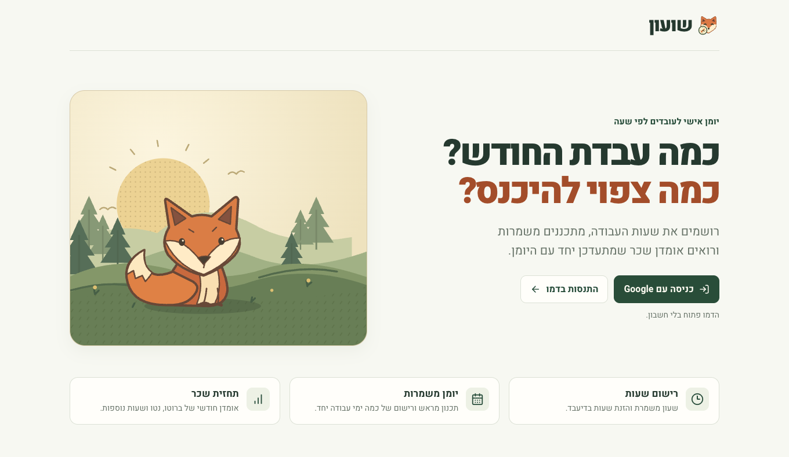
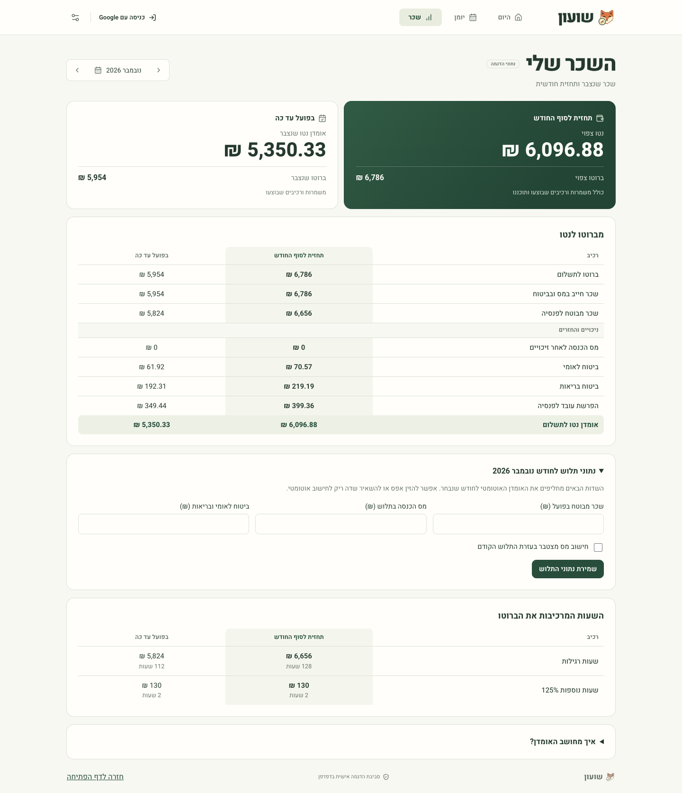
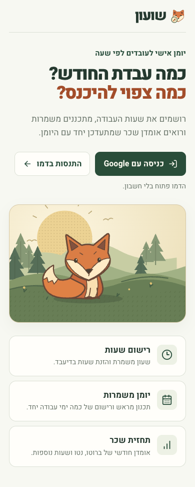
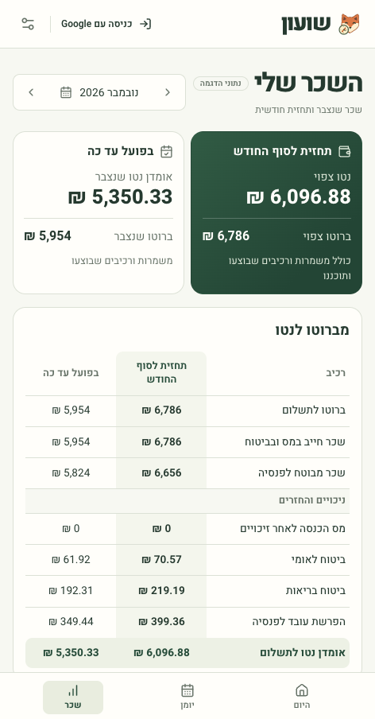

# שועון 🦊

יומן משמרות אישי בעברית לעובדים לפי שעה בישראל. רושמים שעות בזמן אמת או בדיעבד, מתכננים משמרות מראש ורואים כמה שכר כבר נצבר וכמה צפוי עד סוף החודש.

**[פתיחת שועון](https://shuon-shifts-il.web.app/)** · **[התנסות בדמו בלי חשבון](https://shuon-shifts-il.web.app/demo)** · [מדריך חישוב השכר](docs/payroll.md)



## מתחילים להשתמש

1. **כדי לנסות** פותחים את דף הבית כאורחים ובוחרים **התנסות בדמו**. הדמו מגיע עם משמרות לדוגמה, והשינויים בו נשמרים באותו דפדפן.
2. **כדי לפתוח יומן אישי** בוחרים **כניסה עם Google** ועונים על שלוש שאלות קצרות על תעריף לשעה, יום מנוחה ופנסיה. החשבון מתחיל ביומן ריק. [צילום השאלון בכניסה הראשונה](docs/screenshots/pay-questionnaire.png)
3. **בכניסות הבאות** דף הבית פותח ישירות את הדשבורד **היום שלי** כל עוד החשבון מחובר.

## מה יש בכל מסך

| מסך | מה עושים בו |
| --- | --- |
| **היום שלי** | מתחילים ומסיימים משמרת, רושמים הפסקות ורואים גרף שעות שבועי. לצד השעון מופיעים הברוטו של החודש הקודם, אומדן הנטו שנצבר החודש והתחזית לסופו. |
| **יומן המשמרות** | בודקים מה עבדתם ומה מתוכנן, מזינים שעות בדיעבד ומחילים אותן שעות על כמה ימים. משמרת לילה מוצגת לפי השעות שעבדתם בכל יום. |
| **השכר שלי** | בוחרים חודש ומשווים בין מה שנצבר בפועל לבין התחזית הכוללת משמרות מתוכננות. הדוח מפרט ברוטו, נטו משוער, ניכויים ושעות נוספות. |
| **הגדרות** | מעדכנים את שאלון השכר, תעריפים לפי תאריך, ימי מנוחה וחגים ותבניות משמרת. אפשר לבחור מראה בהיר, כהה, מרווה או התאמה למכשיר. |


| יומן משמרות | דוח שכר |
| --- | --- |
| [](docs/screenshots/calendar.png) | [](docs/screenshots/salary.png) |

### שועון בנייד

| דף הפתיחה | יומן המשמרות | דוח השכר |
| --- | --- | --- |
| <a href="docs/screenshots/landing-mobile.png"></a> | <a href="docs/screenshots/calendar-mobile.png"></a> | <a href="docs/screenshots/salary-mobile.png"></a> |

<details>
<summary>עוד מסכים ותצוגות</summary>

- **ניהול משמרת** · [שעון נוכחות פעיל](docs/screenshots/clock-active-fox.png) · [סיכום משמרת](docs/screenshots/shift-finished-mobile.png) · [פרטי משמרת](docs/screenshots/shift-detail-mobile.png)
- **תכנון ועריכה** · [עורך משמרת](docs/screenshots/shift-editor-mobile.png) · [בחירת ימים נוספים](docs/screenshots/shift-day-picker-mobile.png) · [בחירת חודש ושנה בדוח](docs/screenshots/salary-month-picker.png)
- **חשבון** · [מסך היום בנייד](docs/screenshots/today-mobile.png) · [תשובות לשאלון השכר](docs/screenshots/pay-questionnaire-settings.png)
- **מצב כהה** · [מסך היום](docs/screenshots/today-dark.png) · [יומן המשמרות](docs/screenshots/calendar-dark.png) · [דוח השכר בנייד](docs/screenshots/salary-dark-mobile.png)

</details>

## איך מחושב אומדן השכר

שועון מחשב שכר לעבודה שעתית אצל מעסיק אחד בישראל לפי התעריף שהיה בתוקף ביום העבודה. הברוטו מביא בחשבון שעות נוספות, עבודה בלילה, שבת וחגים והפסקות ללא תשלום. אומדן הנטו משתמש בכללי 2026 ומפרט מס הכנסה, נקודות זיכוי, ביטוח לאומי ובריאות והפרשת עובד לפנסיה. אפשר לעדכן נתונים לפי התלוש, למשל ניכויים ורכיבי שכר נוספים. [הנחות החישוב, דוגמאות ומקורות](docs/payroll.md)

משמרת מתוכננת מופיעה בתחזית עד שעת הסיום שלה, ואז עוברת לחישוב בפועל. אם המשמרת בוטלה, אפשר למחוק אותה מהיומן. משמרת שנרשמת בשעון הנוכחות נכנסת לחישוב ברגע שסוגרים אותה.

## נתונים וחיבור ליומן Apple

האתר החי מתארח ב־Firebase בפרויקט `shuon-shifts-il`. ההתחברות מתבצעת עם Firebase Authentication, וכללי Firestore מגבילים את הגישה לנתוני החשבון. הדמו שומר את הנתונים בדפדפן.

הקוד כולל סנכרון דו־כיווני ליומן iCloud דרך CalDAV. הסנכרון באתר החי מושבת במסלול Spark, והפעלתו דורשת מעבר ל־Blaze והגדרת הפונקציות. שינויים שמגיעים מ־iCloud למשמרת שהסתיימה דורשים אישור בשועון. [התקנה, סנכרון ובדיקות iCloud](functions/README.md)

## פיתוח מקומי

נדרשים Node.js 22 ו־npm. התצורה הציבורית של Firebase כלולה בקוד. ההרצה הרגילה מאפשרת לפתוח את הדמו בדפדפן בכתובת שמציג Vite.

```sh
npm ci
npm run dev
```

לבדיקת התחברות ושמירה בסביבה מקומית מבודדת נדרשים גם Firebase CLI ו־Java 21 ומעלה. מתקינים את תלויות הפונקציות ומפעילים את האמולטורים במסוף אחד.

```sh
npm ci --prefix functions
npm run dev:emulators
```

במסוף שני מפעילים את הלקוח מול האמולטורים. בחלון ההתחברות אפשר ליצור משתמש בדיקה בפרויקט `demo-shuon`. [משתני סביבה לפרויקט Firebase אחר](.env.example)

```sh
VITE_FIREBASE_EMULATORS=true npm run dev
```

### בדיקות ופריסה

```sh
npm test                    # שעות, שכר ושמירת משמרות
npm run typecheck           # TypeScript
npm run test:rules          # הרשאות Firestore עם אמולטור זמני
npm test --prefix functions # פונקציות יומן Apple
```

בונים את האתר ופורסים אותו ל־Firebase Hosting.

```sh
npm run build
firebase deploy --only hosting --project shuon-shifts-il
```

את כללי הגישה ב־Firestore פורסים בפקודה נפרדת.

```sh
firebase deploy --only firestore:rules --project shuon-shifts-il
```

### תצוגת שיתוף

הכותרת והתיאור של הקישור מוגדרים ב־[`index.html`](index.html). כרטיס השיתוף משתמש בתמונת JPEG בגודל 1200×630. כשמחליפים את התמונה, מעדכנים את שם הקובץ ואת כתובת `og:image` כדי שסורקי השיתוף יוכלו לטעון אותה מחדש.

[](public/share-card-v1.jpg)

### מפת הקוד

| תיקייה | מה נמצא בה |
| --- | --- |
| [`src/components`](src/components) | דף הפתיחה, הדשבורד, היומן, עורך המשמרות, דוח השכר וההגדרות |
| [`src/data`](src/data) | מודל הנתונים, Firebase, נתוני הדמו ושמירת משמרות |
| [`src/domain`](src/domain) | חישובי זמן לפי שעון ישראל, שעות עבודה, ברוטו, מסים ונטו |
| [`functions`](functions) | חיבור ל־iCloud, הצפנה וסנכרון |
| [`tests`](tests) | מקרי ייחוס לחישובי שכר ושעות, הרשאות ושמירה מקבילית |
